

<picture><source media="(prefers-color-scheme: dark)" srcset="img/dark/header-r3.svg"/>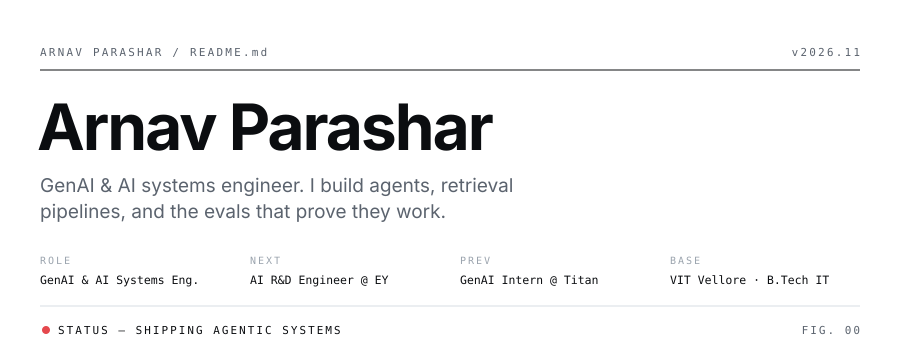</picture>

<a href="https://drive.google.com/file/d/1GzHQ9uWKsvVUwljpnoStHJ-qZZIVXS54/view?usp=sharing"><picture><source media="(prefers-color-scheme: dark)" srcset="https://img.shields.io/badge/RESUME-0d1117?style=flat-square&logo=readdotcv&logoColor=ffffff"/></picture></a>
<a href="https://www.linkedin.com/in/arnav-parashar-920212240/"><picture><source media="(prefers-color-scheme: dark)" srcset="https://img.shields.io/badge/LINKEDIN-0d1117?style=flat-square&logo=linkedin&logoColor=ffffff"/></picture></a>
<a href="https://github.com/Arnavparashar?tab=repositories"><picture><source media="(prefers-color-scheme: dark)" srcset="https://img.shields.io/badge/REPOSITORIES-0d1117?style=flat-square&logo=github&logoColor=ffffff"/></picture></a>

<picture><source media="(prefers-color-scheme: dark)" srcset="img/dark/s01-r3.svg"/>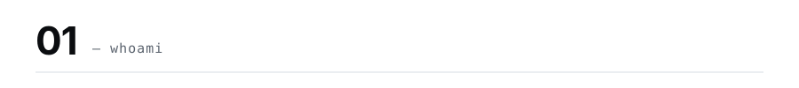</picture>
<picture><source media="(prefers-color-scheme: dark)" srcset="img/dark/whoami-r3.svg"/>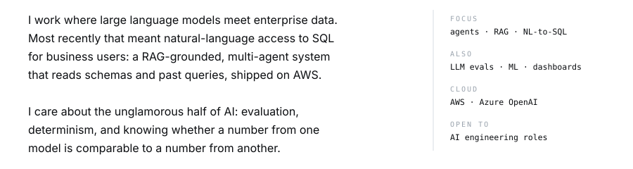</picture>
<picture><source media="(prefers-color-scheme: dark)" srcset="img/dark/s02-r3.svg"/>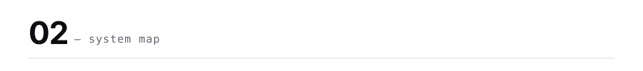</picture>
<picture><source media="(prefers-color-scheme: dark)" srcset="img/dark/sysmap-r3.svg"/>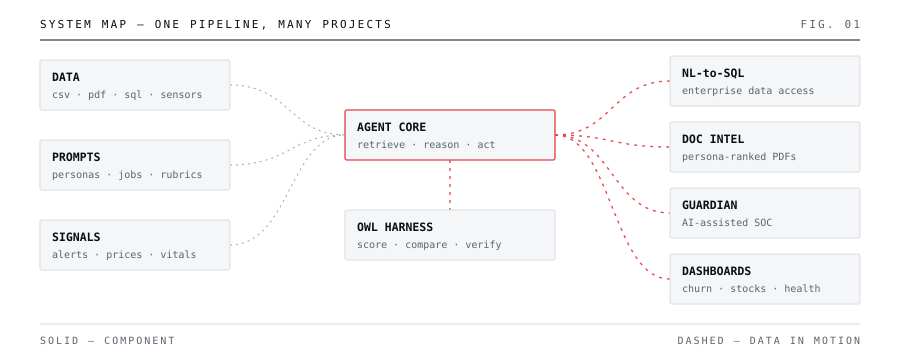</picture>
<picture><source media="(prefers-color-scheme: dark)" srcset="img/dark/s03-r3.svg"/>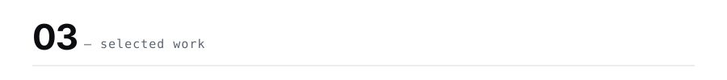</picture>
<picture><source media="(prefers-color-scheme: dark)" srcset="img/dark/projects-r3.svg"/>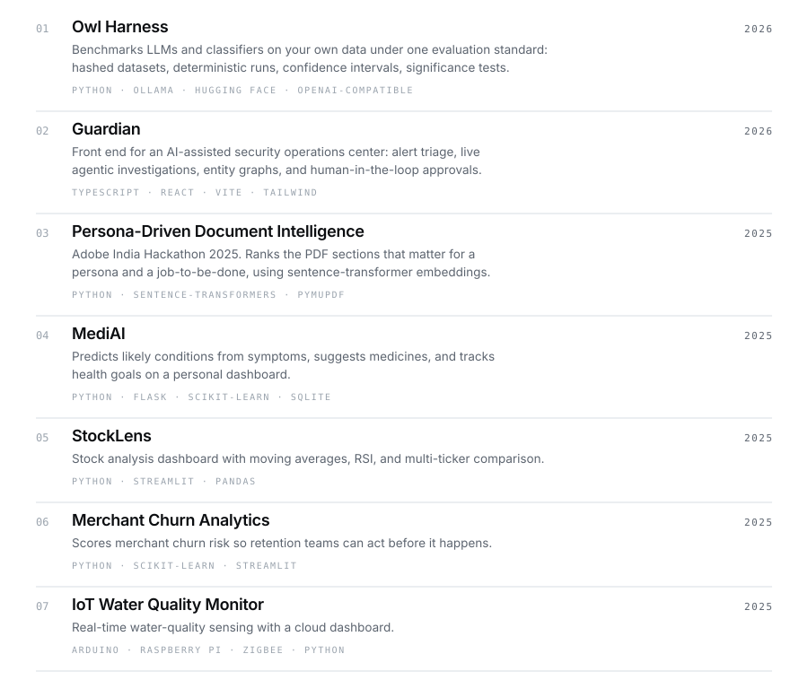</picture>

<a href="https://github.com/Arnavparashar/Owl-Harness">01 Owl Harness</a> ·
<a href="https://github.com/Arnavparashar/guardian_wf">02 Guardian</a> ·
<a href="https://github.com/Arnavparashar/Round-1B-Persona-Driven-Document-Intelligence">03 Doc Intelligence</a> ·
<a href="https://github.com/Arnavparashar/MediAI">04 MediAI</a> ·
<a href="https://github.com/Arnavparashar/StockLens">05 StockLens</a> ·
<a href="https://github.com/Arnavparashar/Customer_churn_dashboard">06 Churn Analytics</a> ·
<a href="https://github.com/Arnavparashar/IoT-Enabled-Real-Time-Water-Quality-Monitoring-Framework-">07 IoT Water Quality</a>

<picture><source media="(prefers-color-scheme: dark)" srcset="img/dark/s04-r3.svg"/>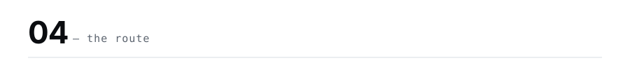</picture>
<picture><source media="(prefers-color-scheme: dark)" srcset="img/dark/route-r3.svg"/>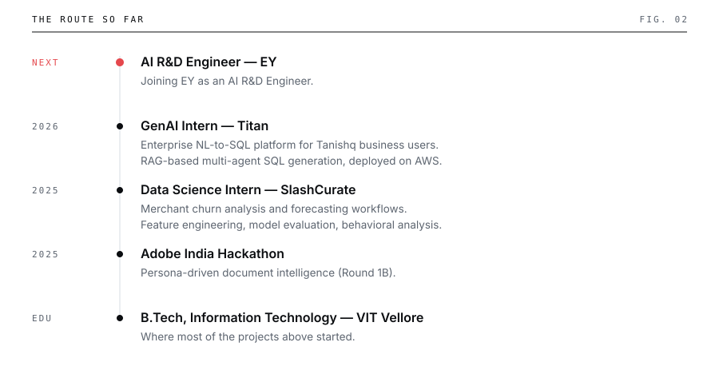</picture>
<picture><source media="(prefers-color-scheme: dark)" srcset="img/dark/s05-r3.svg"/>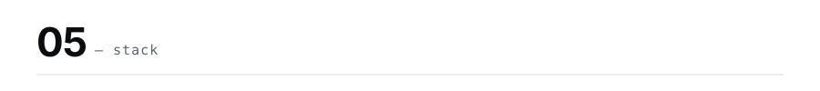</picture>
<picture><source media="(prefers-color-scheme: dark)" srcset="img/dark/stack-r3.svg"/>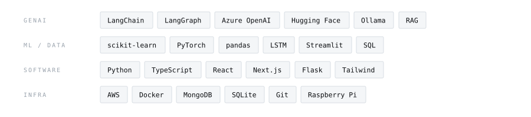</picture>
<picture><source media="(prefers-color-scheme: dark)" srcset="img/dark/footer-r3.svg"/>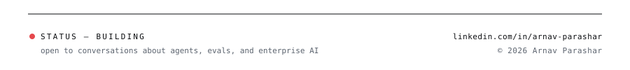</picture>
